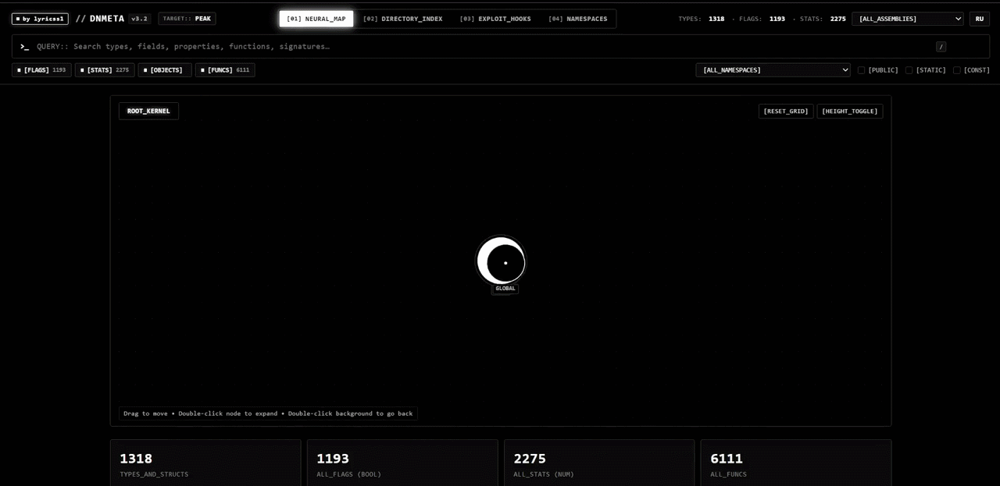

# dnmeta

**See everything inside a Unity (Mono) games code in one click, with zero dependencies.**

dnmeta reads `Assembly-CSharp.dll` (and any other managed DLL) straight from the game folder and produces:

- `index.html` - an interactive, fully offline viewer: search, filters, namespaces, type details, copy‑paste ready signatures
- `tree.txt` - a complete text tree of every type, field, property, event and method

Written in plain **C99**. No .NET, no Mono, no dnSpy, no libraries. It parses the PE / CLI metadata tables (ECMA‑335) by itself, so it is tiny and fast.

## Why

When you start modding a game you need to know *what is in it*: which classes exist, what the player class stores, which fields are `static`, which methods you can hook, which values are constants. dnmeta answers that in seconds, without opening a decompiler and without running the game.

## Features

- Walks the whole game folder: finds `<Game>_Data/Managed` automatically (also `.app` bundles), or takes a `Managed` folder, or a single `.dll`
- Types: classes, structs, interfaces, enums (with underlying type and constant values), delegates, nested types, generics
- Members: fields (with constants), properties (getter/setter access, indexers), events, methods (modifiers, generic params, `ref`/`out`, parameter names)
- Custom attributes, base types and implemented interfaces
- Optional metadata tokens and RVA (`-t`) for patching and hooking
- Detects IL2CPP games and tells you clearly instead of failing
- Single self‑contained HTML report - open it anywhere, send it to a friend
- Interface in English and Russian

## Build

You only need a C compiler.

    gcc -O2 -std=c99 -o dnmeta src/*.c

Windows (gcc):

    build.bat

`src/ui.c` (the embedded viewer) is generated from `web/` by `tools/embed.c`. If you edit anything in `web/`, run `build.bat` again. A generated `src/ui.c` is committed, so the one‑line gcc command above always works.

## Usage

    dnmeta "D:\Games\Game"
    dnmeta "D:\Games\Game\Game_Data\Managed" --all
    dnmeta Assembly-CSharp.dll -o out

Run it without arguments and it asks for the game folder (you can drag the folder into the window).

Then open `dnmeta_report/index.html`.

### Options

| option | meaning |
|---|---|
| `-o <dir>` | output folder (default `./dnmeta_report`) |
| `--all` | read every DLL in `Managed` (default: `Assembly-CSharp*.dll`) |
| `--inc a,b` | also read DLLs whose name contains `a` or `b` |
| `--no-tree` | do not write `tree.txt` |
| `--tree` | also print the tree to the console |
| `-g` | include compiler‑generated types and members |

`tree.txt` formatting: `-p` public only, `-a` attributes, `-t` tokens/RVA, `-s` short names, `-T` types only, `-f <text>` filter by type name, `--ascii` ASCII tree characters.

## Example `tree.txt`

    Assembly-CSharp
    └── namespace Game (120 types)
        └── public class Player : MonoBehaviour
            ├── Fields (3)
            │   ├── public float speed
            │   ├── public int health
            │   └── private static Player instance
            └── Methods (2)
                ├── public void TakeDamage(float amount)
                └── private void Die()

## Limits

- Mono games only. IL2CPP builds have no managed `Assembly-CSharp.dll`; they need a `global-metadata.dat` dumper.
- dnmeta shows structure and signatures. It does not decompile method bodies (IL).

## Disclaimer

For learning, interoperability and modding of games you own. Do not use it to cheat in online games or to break a games terms of service.
